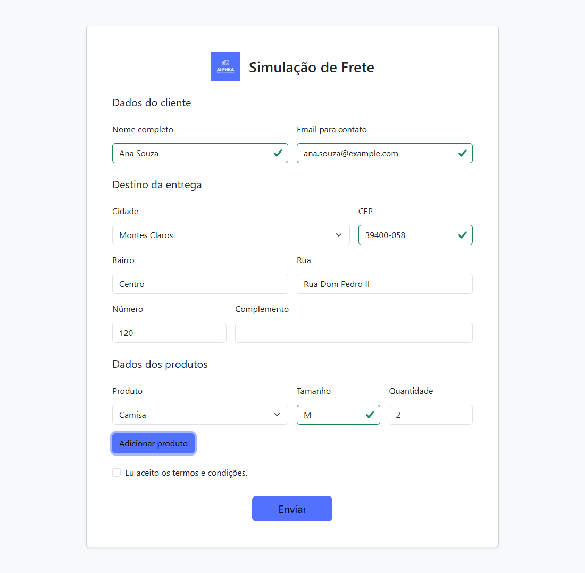
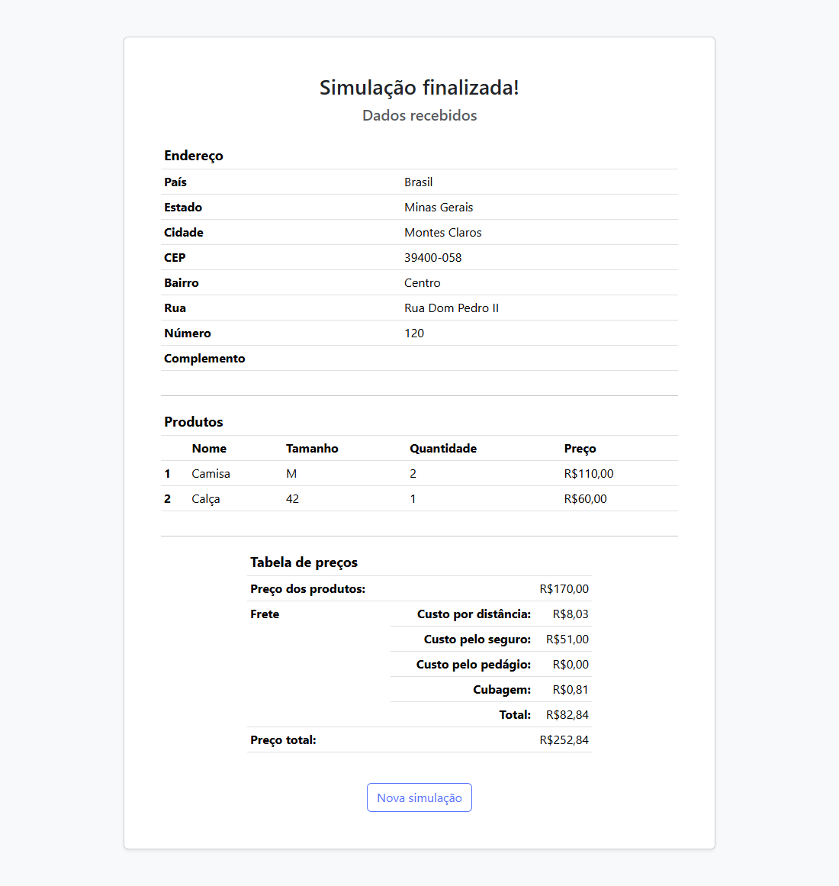

# Freight Simulator

**English** | [Português (Brasil)](README.pt-BR.md)

<div align="center">
	<a href="https://github.com/Alphka/Freight-Simulator">
		
	</a>
	<h5>
		Website prototype that calculates freight prices, requested by SENAI
		<br>
		Created for the fictitious company Alphka
	</h5>
</div>

<br>

<p align="center">
	<a href="https://github.com/Alphka/Freight-Simulator/actions/workflows/ci.yml">
		
	</a>
	<a href="LICENSE.md">
		
	</a>
</p>

## Description

A static website, written in TypeScript, that simulates the freight price of an order for the fictitious company Alphka. It was built as a prototype requested by SENAI (a course assignment). The interface is in Brazilian Portuguese.

## How it works



On the home page, the user provides some personal data for identification, the data of the desired products and the destination address of the delivery.



After the form is submitted, the site calculates the freight price using the product information, the distance between the origin and the delivery destination, among other data. The form is sent with the `GET` method to `fullfilled.html`, which reads the values from the URL; there is no backend.

## Features

- Order form with several products (shirt, pants, dress and jacket), each with its size and quantity.
- Selection of the destination city among the ones registered in the project (Montes Claros, Mirabela, Bocaiúva and São Francisco).
- Form validation, including the postal code (CEP) of the chosen city. For Montes Claros, the CEP is looked up in the [ViaCEP](https://viacep.com.br) API.
- Result page with the address, the products, the freight breakdown and the total price.

## Freight calculation

- Distance cost: `Cost per kilometer × Distance`
- Insurance cost: `30% × Products price`
- Toll cost (if any): `Toll price × Number of trucks`
- Cubage cost: `Volume / Cubage factor × Price per ton`

The final freight price is the sum of all the previous costs and the minimum service price. When the cubic space of the order exceeds the truck's, the number of trucks is increased and the service price and the toll are multiplied by it. The total shown is the products price plus the freight.

## Tech stack

- [TypeScript](https://www.typescriptlang.org/) (compiled as ES modules for the browser)
- [Vite](https://vite.dev/) for the development server and the build (multi-page, with source maps)
- [Sass](https://sass-lang.com/) for the styles
- [Bootstrap 5](https://getbootstrap.com/) (only the Sass parts used by the site, bundled by Vite)
- [IMask](https://imask.js.org/) for input masks (installed from npm and bundled)
- [pnpm](https://pnpm.io/) as the package manager

## Requirements

- [Node.js](https://nodejs.org/) `22.23.4`, `24.22.1` or `26.x` (`26.3.0` and `26.12.1` were tested). The CI workflow builds the project on the latest release of Node.js 22, 24 and 26.
- [pnpm](https://pnpm.io/) `11` or `12`. The exact version is pinned in the `packageManager` field of `package.json`, so it is selected automatically.
- Internet access when using the CEP lookup, since it calls the ViaCEP API. Bootstrap and IMask are bundled with the site.

## Installation

Install the project dependencies:

```sh
pnpm install
```

## Usage

Start the development server (with hot reload):

```sh
pnpm dev
```

Build the site into the local `dist` folder and preview it:

```sh
pnpm build
pnpm preview
```

> [!NOTE]
> The built files use `type="module"` scripts, which browsers do not run from local files (`file://`). Use `pnpm dev` or `pnpm preview`, or any static server.

### Scripts

| Script | Description |
| --- | --- |
| `pnpm dev` | Starts the Vite development server |
| `pnpm build` | Builds the pages, scripts and styles into `dist`, with source maps |
| `pnpm preview` | Serves the `dist` folder locally |
| `pnpm typecheck` | Type-checks the Vite configuration and the TypeScript sources without emitting files |

## Browser support

The supported browsers are listed in the `browserslist` field of `package.json` (Chrome and Edge 111+, Firefox 114+, Safari and iOS 16.4+). They match the default `build.target` of Vite, and are also used to prefix and minify the CSS.

## Deployment

The site is static and is deployed on [Vercel](https://vercel.com/). The [`vercel.json`](vercel.json) file sets the Vite framework and the `dist` output directory, so the project settings in the dashboard do not need to be changed. Vercel installs the dependencies with pnpm because of `pnpm-lock.yaml`.

The file also sets long-lived cache headers for the hashed files in `/assets` and security headers, including a Content Security Policy that only allows the site itself and the ViaCEP API. If the site starts to use another external service, add its origin to the matching directive (for example `connect-src`) in `vercel.json`.

## Project structure

```text
src/
├── public/          Files copied as they are to the root of the build (images and web manifest)
├── scripts/         TypeScript source (including data.ts with cities, products and prices)
├── styles/          Sass stylesheets (main.scss imports the Bootstrap parts in use)
├── typings/         Type declarations
├── index.html       Order form page
└── fullfilled.html  Result page
docs/                Screenshots used in this README
vite.config.ts       Vite configuration
tsconfig.json       TypeScript configuration (one project for the sources and the Vite config)
vercel.json          Vercel configuration
```

## Tests

The project has no automated tests.

## License

This project is licensed under the [ISC License](LICENSE.md).
